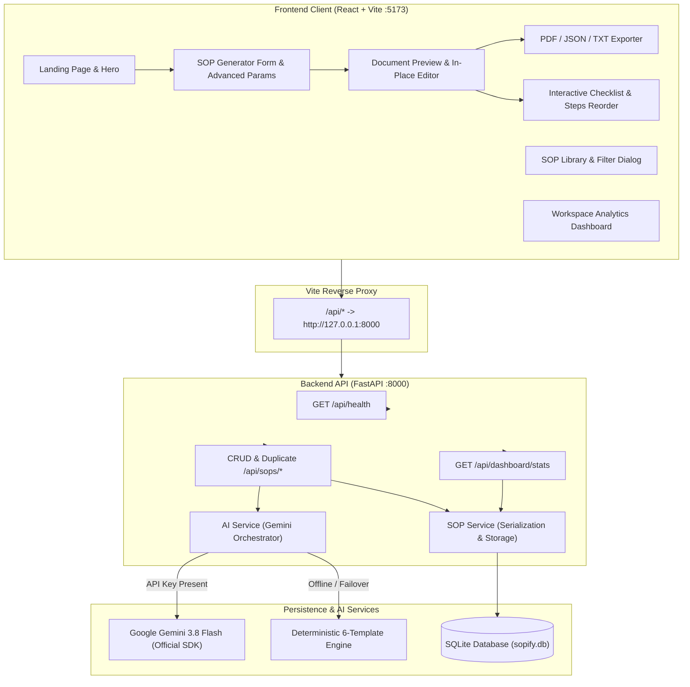

# SOPify System Architecture

## 1. System Overview

**SOPify** is an enterprise-grade AI application that transforms high-level business process descriptions into structured, actionable, and auditable Standard Operating Procedures (SOPs).

The system consists of three primary layers:
1. **Frontend Presentation & Interaction Layer**: Built with React and Vite, delivering an editorial enterprise UI (inspired by HITIT's corporate design language), real-time in-place document editing, dynamic procedure reordering, interactive checklist tracking, live metrics dashboard, and browser print-to-PDF export.
2. **Backend API & Service Layer**: Built with Python, FastAPI, Pydantic, and Uvicorn, exposing RESTful endpoints with strict schema validation, deterministic fallback generation, and database transaction boundaries.
3. **Persistence & AI Engine Layer**:
   - **Database**: SQLite with SQLAlchemy ORM, automatic schema migration, and UTC timestamp auditing.
   - **AI Provider**: Google Gemini API via official Python SDK `google-genai`, operating in JSON Mode (`response_mime_type="application/json"`).
   - **Deterministic Fallback Engine**: 6 comprehensive built-in domain templates (Employee Onboarding, Customer Refund, Incident Response, Customer Support Escalation, Software Deployment, Purchase Approval) and a dynamic custom synthesizer that guarantee 100% demo availability even without internet connectivity or API keys.

---

## 2. Architecture Diagram

---

## 3. Data Flow & Execution Pipeline

### Generation Flow
1. **User Input**: The user inputs a process name, department, objective, and description, with optional parameters (industry, audience, complexity, frequency, governing policies, special instructions).
2. **Client Validation**: Required fields are validated; double-submission protection prevents duplicate clicks.
3. **API Request**: The payload is sent to `POST /api/sops/generate`.
4. **AI Generation / Synthesis**:
   - If `GEMINI_API_KEY` is configured: sends a prompt to Gemini 3.8 Flash demanding structured JSON matching `SOPDocument`.
   - If `GEMINI_API_KEY` is omitted or Gemini encounters rate limits or errors: `ai_service.py` safely routes the request to `_sample_sop`, generating a complete, realistic procedure.
5. **Persistence**: The resulting SOP is saved to SQLite as a `draft` with auto-increment ID and timestamps.
6. **Delivery**: The complete document with `record_id` is returned to the frontend and rendered in the live editor.

### In-Place Editing & Synchronization
- Users can toggle **Edit Mode** to modify title, objective, purpose, scope, step descriptions, owners, expected outcomes, verification methods, and checklist labels.
- Procedure steps can be dynamically added, deleted, or reordered (Move Up / Down).
- Checklist items can be toggled, added, or deleted.
- When the user clicks **Save to Database**, `PUT /api/sops/{record_id}` updates the persisted record in SQLite and refreshes the modification timestamp.

### Dashboard & Analytics
- The dashboard queries `GET /api/dashboard/stats`.
- The backend executes SQL aggregation queries (`COUNT`, `GROUP BY department`, `ORDER BY updated_at DESC LIMIT 5`) and returns exact counts.
- The UI displays total SOPs, status counts (Draft, In Review, Approved), department breakdown bars, and recent activity logs.

---

## 4. Key Design Decisions

1. **Zero External Microservice Overhead**: SQLite and SQLAlchemy are used to keep local setup trivial for Windows and cross-platform hackathon demos without requiring PostgreSQL, Docker, or Redis.
2. **Backend Secret Isolation**: The frontend has no knowledge of Gemini credentials. All AI calls flow strictly through FastAPI.
3. **Resilient Failover**: If the Gemini API is blocked by firewall, invalid key, or quota limits, the user experience does not fail; high-quality sample data is returned with clear source indicators.
4. **Print-Friendly Styling**: Browser print-to-PDF uses scoped `@media print` CSS rules that suppress toolbars, inputs, buttons, and navigation while formatting the SOP document into standard A4 margins.
